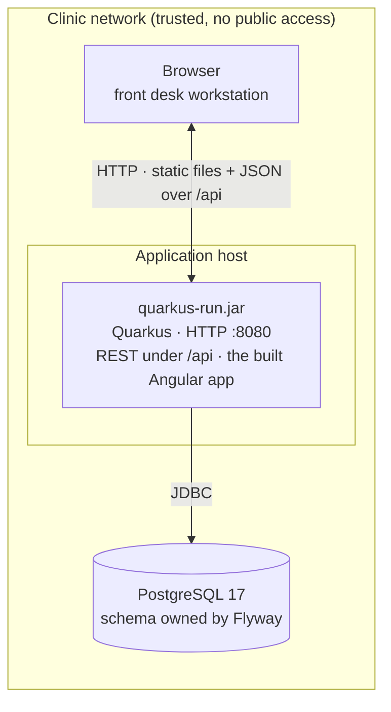

# Physical View

**Question:** Where does the system run?  
**Artifacts:** this document (deployment diagram, environments, constraints)  
**Notation:** Mermaid deployment diagram, Markdown  
**For the agent:** the boundary conditions. An agent that knows the database is
PostgreSQL, that the UI state lives in the browser, and that the app runs on
a trusted network inside the clinic decides differently from one that does not.

## Deployment

Two nodes, one process each. No reverse proxy, no cache, no message broker, no
second service — the Logical and Process views have nothing that would need one.
The Angular app is built into `frontend/dist/` and served by Quarkus as static
content; `core/SpaRouting` answers every other non-`/api` path with `index.html`.

## Environments

| Environment      | How it starts                                                            | Database                                                                   | Notes                                                                                                           |
|------------------|--------------------------------------------------------------------------|----------------------------------------------------------------------------|-----------------------------------------------------------------------------------------------------------------|
| **Local dev**    | `./mvnw quarkus:dev` + `npm start` in `frontend/`                    | the local PostgreSQL (`vb-postgres start`), cleaned and migrated, seeded   | No Docker. Open http://localhost:4200, which proxies `/api` to :8080; Quarkus live reload is active             |
| **Build / test** | `./mvnw test` · `./mvnw verify` (after `npm run build` in `frontend/`)   | `petclinic_test` on localhost:5432, cleaned and migrated at test start     | Needs the local PostgreSQL (C-007); `./mvnw test -Dgroups=sensor` alone does not                                                    |
| **CI**           | GitHub Actions, `ubuntu-latest`, JDK 25, Node 24, `npm run build`, `mvn -B verify` + Sonar scanner | a PostgreSQL 17 service container on the runner                          | `.github/workflows/build.yml`; caches `~/.m2` and the Playwright browsers                                       |
| **Production**   | `java -jar target/quarkus-app/quarkus-run.jar` (from `./mvnw package`)   | an external PostgreSQL 17, credentials from the environment                | Target state — **nothing is deployed today**; see *Not there yet*                                               |

Flyway runs at startup and brings the schema to the current version. The
test-only `V2__seed_reference_data.sql` lives on the test classpath and never
reaches a production database.

## Runtime constraints

- **UI state lives in the browser; the server is stateless.** The Angular app
  holds the open form and the loaded lists, and every request to `/api` stands on
  its own. One instance is assumed; a second one behind a load balancer would
  need no session affinity.
- **One database, no read replicas.** Every query goes to the primary.
- **PostgreSQL only** (C-005). The migrations use PostgreSQL sequences and the
  entities map a PostgreSQL schema — the SQL is not portable, and it
  is not meant to be.
- **Port 8080** by default. Nothing but the Angular app and `/api` is served:
  SmallRye Health is deliberately not on the classpath, because no requirement asks
  for a health or metrics endpoint and an unsecured one would be the first thing
  to lock down.

## Security and data

- **No authentication, no authorization** (C-010). Whoever reaches the
  application can do everything a Clinic User can, including reading and
  changing customer data. This is deliberate for the demo and is the single
  precondition of the whole deployment: **the application may not be exposed
  beyond the clinic's own network.** Adding authentication is the first change a
  real deployment needs, and it changes the Use Case View too (the Visitor /
  Clinic User split becomes enforced instead of implied).
- **TLS is not terminated by the application.** If it is needed, it belongs in
  front of the app.
- **Owner records are personal data** — name, address, telephone. No backup
  schedule, retention period, or hosting location is specified anywhere in
  `docs/`, and none can be invented here. For a real clinic these have to be
  supplied before deployment.

## Not there yet

Honest list of what a production deployment would add. None of it exists in the
repository today, so an agent should not pretend to change it:

- no container image (`quarkus-container-image-jib` would produce one),
- no infrastructure as code, no deployment pipeline beyond the CI build,
- no externalized production configuration (`quarkus.datasource.*` points at
  `localhost:5432` in every environment that exists today),
- no monitoring, log aggregation, or alerting,
- no backup or restore procedure,
- no availability target, and no measured response-time budget to hold the
  "keeps up with a conversation" goal from the vision to.
