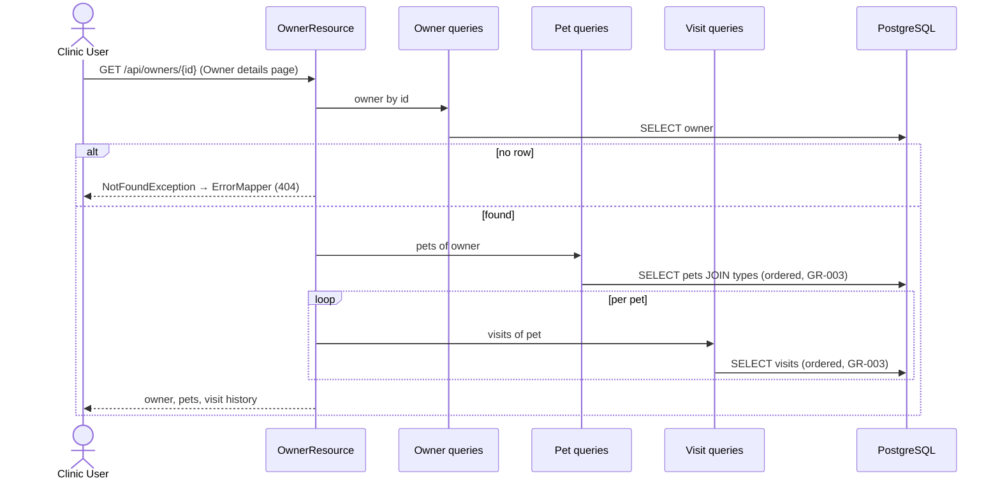
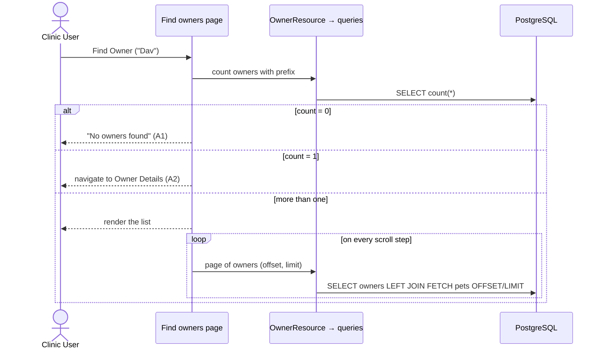
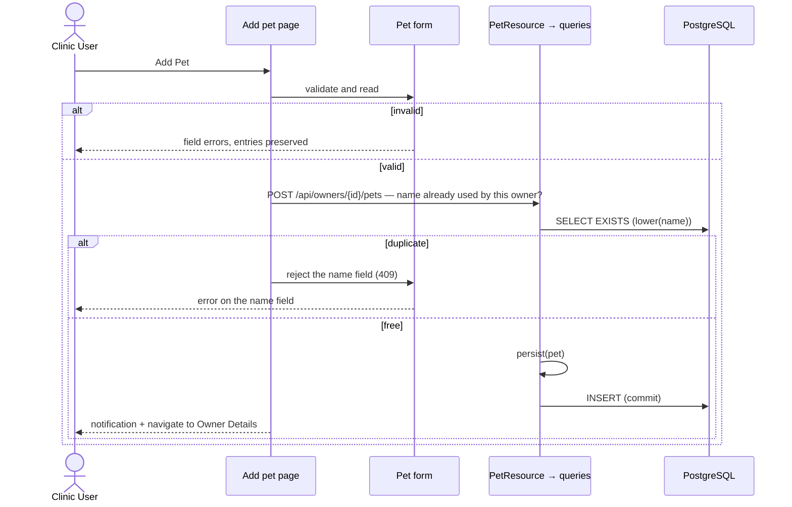

# Process View

**Question:** How does the system behave at runtime?  
**Artifacts:** this document (sequence diagrams, transaction boundaries,
concurrency rules)  
**Notation:** Mermaid sequence diagrams, Markdown for rules  
**For the agent:** where a transaction begins and ends, what runs in the
background (nothing, today), and which races are accepted. Without this view an
agent quietly builds everything into one synchronous request — which happens to
be right here, but for reasons worth knowing.

## Runtime shape

One server process. The UI is an Angular app in the browser: a page sends an
HTTP request to `/api`, a resource method runs, JPA queries go to
PostgreSQL, and the JSON answer travels back for the page to render. There is
no server-side session and no second server runtime.

- **One page instance per navigation.** Routed pages are Angular components created
  per navigation; their state (the loaded owner, the form contents) lives in the
  browser, in the page's signals, until the user navigates away.
- **Repositories are singletons and stateless.** They are `@ApplicationScoped` and hold
  no fields, so nothing about a user survives in them.
- **Requests are independent.** Quarkus runs each resource method on a worker
  thread; two requests of the same user may overlap and share only the database.

## Reading a screen — UC-005 View Owner Details

The per-pet loop is an accepted `1 + 1 + n` — `n` is the number of pets of one
owner, which is small and bounded. The lists that are *not* bounded never do
this; see *Query cost* below.

## Searching — UC-004 Find Owners by Last Name

## Writing — UC-007 Add Pet to Owner

Every write in the application follows this shape: **validate in the form →
check what the database alone cannot check → one statement → confirm →
navigate.** The confirmation is not decoration; FR-022 requires it.

## Transaction boundaries

**The repository is the transaction boundary.** Every repository is annotated
`@Transactional` (`jakarta.transaction`) at class level, for reads and writes
alike (JTA has no read-only flag). A resource never opens a transaction — what
it returns must already be loaded, or Jackson trips over a lazy association
outside it. `ArchitectureTest.repositoriesAreTransactional` and `resourcesAreNotTransactional`
keep it that way.

What that means per use case today:

- **Every use case writes exactly one row with one statement.** Register owner,
  update owner, add pet, update pet, book visit — one `INSERT` or `UPDATE` each,
  in one transaction of its own.
- **The reads of one screen are separate transactions.** The owner details
  screen (UC-005) loads the owner, the pets, and each pet's visits in several
  transactions, not one. Consistent per read, not across the screen — acceptable
  for a front desk reading one owner, and the alternative would mean holding a
  transaction across a resource method.
- **A transaction never spans a user interaction.** The duplicate-name check and
  the insert that follows it are two transactions, deliberately; see below.

**The rule for the next use case:** the moment a use case needs *two* statements
to succeed or fail together, write **one** `@Transactional` method in the
owning module's `domain` package that performs both, and add a line here saying
which use case made it necessary. Two calls from a resource are two transactions, no
matter what the resource does between them.

## Concurrency

- **A rule that needs a lookup before the write is a check-then-act.** The one
  that has it today is
  [GR-006](../business_rules.md#gr-006-unique-pet-name-per-owner) (UC-007 /
  UC-008 BR-001): the lookup and the `INSERT` are two transactions with nothing
  holding them together, so two clerks writing the same value for the same owner at
  the same moment can both pass the check. The database is the backstop —
  `pets_owner_name_unique` is a unique index on `(owner_id, lower(name))`, which
  compares the way the rule says it must, so the loser of the race gets a
  `ConstraintViolationException` from Hibernate, mapped to a 500 by `ErrorMapper`
  and shown in the page's error panel. The check in the resource exists to turn
  the common case into a field-level error instead of an error page.

  **The shape generalizes:** a rule the database cannot express alone is checked
  before the write, and where the data must never break it, a constraint that
  compares the same way is the backstop. Never the check alone.

- **Updates are last-write-wins.** No version column, no optimistic locking. Two
  clerks editing one record: the later save silently wins. No use case asks for
  more, and adding it would change the use cases that update — so it is a
  specification change first and a code change second.

- **No pessimistic locks, no `SELECT … FOR UPDATE`.**

## Synchronous and asynchronous processing

Everything is synchronous, inside the user's request:

| Mechanism                      | Used? |
|--------------------------------|-------|
| Batch jobs / schedulers        | no    |
| Message queues / domain events | no    |
| `Uni`, background threads      | no    |
| SSE, WebSockets / server push  | no    |
| Caching layer                  | no    |

An agent must not introduce any of them to solve a problem the specification
does not pose. If a use case ever needs one, it changes this table and gets an
ADR.

## Query cost

- **Unbounded lists load lazily** ([GR-002](../business_rules.md#gr-002-lazy-loading-of-lists),
  NFR-001/002): `findPage(offset, limit)` plus
  a paired `count()`, behind `GET /api/…?offset=&limit=`. Rows fetched per
  scroll step do not grow with the table size.
- **To-many data in a lazy list is fetched with `left join fetch`** so a list
  never issues a query per row — the owner search results with their pet names
  (UC-004) and the vet directory with its specialties (UC-002).
- **Indexes carrying this:** `owners_last_name_idx` (prefix search),
  `pets_owner_name_unique` (leads with `owner_id`, so it serves the lookups by
  owner as well as the uniqueness check), `visits_pet_id_idx`.

## Failure paths

| At runtime                                  | Result                                                  |
|---------------------------------------------|---------------------------------------------------------|
| Entity missing in the resource              | `NotFoundException` → `ErrorMapper`, HTTP 404            |
| Route the frontend does not have            | `NotFoundPage` (the `**` route)                          |
| Anything else thrown                        | `ErrorMapper`, HTTP 500                                  |
| `SQLException` from Hibernate               | already a `PersistenceException` (a `RuntimeException`), handled as above |

Both error pages render **inside the shell** (`app.html`), so the drawer and header stay
usable (NFR-005), and both show the message only — never a stack trace
(NFR-004, UC-010 BR-003). `/oups` (`CrashPage` → `CrashResource`) exists to demonstrate this path
on purpose (UC-010 BR-004).
